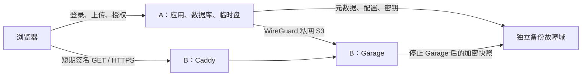

# V1 双节点部署与恢复

本地实现已提供；真实 A/B、域名、独立备份位置尚未准备。本文的 Linux/Docker 部署模板必须在实际机器验证后才用于真实数据。当前 S3 浏览器测试使用内存模拟器，不能作为 Garage 兼容性报告。

## 拓扑与资源

A/B 规格、预算、带宽和可接受停机窗口由实际机器决定。512GB 机器不能直接设为 512GB 对象预算；先扣系统、日志、Garage 元数据和维护余量。A 上传预留 3 倍文件大小，ZIP 预留最坏情况下的输出空间，运行余量默认 256MiB，可用 `cloudnest.node.disk-reserve-bytes` 调整。预留是保守值，需要用真实峰值校准。

## B 接入

1. 准备 Linux B，在 `/etc/cloudnest-b` 放置 `deploy/dual-node/compose.yml`、`Caddyfile`、由示例复制的 `garage.toml` 和 `.env`。数据目录为 `/var/lib/cloudnest-garage`。所有含密钥的文件使用 root 所有、0600 权限。
2. 独立生成 WireGuard A/B 密钥；按 `wg-a.conf.example`、`wg-b.conf.example` 配置窄范围路由，启动接口后确认 A 能访问 B 的 `10.77.0.2`。示例网段如冲突应整体替换。
3. 在 B 生成 32 字节 RPC 密钥，填入 TOML；应用访问键与秘密分别填入 `.env`。设置公网域名、A 的精确 HTTPS origin。Garage 候选版本依据官方快速入门为 v2.4.1；Caddy 示例为 2.10.2。上线前检查发布说明并记录实际镜像 digest，不使用浮动 latest。
4. 安全组开放 B 的 HTTPS/HTTP 证书端口及限定来源的 WireGuard UDP 端口；S3 的 3900 仅监听 WireGuard 地址；RPC 3901 仅回环。不开公网 S3 写入口、网站桶或管理 API。A/B 时间同步是签名有效的前提。
5. 在 B 的 `/etc/cloudnest-b` 执行 `docker compose -f compose.yml config --quiet`，再执行 `docker compose -f compose.yml up -d`，以 `docker compose -f compose.yml exec garage /garage status` 检查节点。先用可丢弃对象验证。
6. CloudNest 管理员打开“账号与安全 → 服务与存储”，新建 S3 策略：内部地址 `http://10.77.0.2:3900`、桶 `cloudnest`、region **garage**、对应应用凭据。不要用旧 minio 环境配置接入 Garage；旧 minio 签名默认 region 为 us-east-1。
7. 在节点列表执行完整检测。新节点 UNKNOWN 不接收任务；检测通过后再设为默认。配置公网地址 `https://objects.example.com`，完成公网签名小样后才开启直连。不要对签名结果替换域名。

新旧管理 API 共用节点约束。节点停用、暂停和维护均阻止新上传/迁入，已有会话与任务固定原 backend 排空。实际离线时请求可能失败，不会自动改写到 A。健康检测不持有全局准入锁进行网络 I/O；配置版本变化时丢弃旧探测结果。

默认策略只影响新会话。旧文件、历史版本、回收站、分享固定对象继续按真实 blob.backend 读取。预览、ZIP、WebDAV、Office、版本下载保留原传输路径。

## 独立备份与共同批次

双节点默认采用 split 模式：A 停止应用和 Web，生成清单并确认全部远端引用都属于 B → B 停止 Garage → B restic 备份数据与配置、检查仓库元数据并重启 Garage → A 生成对象清单、导出数据库与数据卷 → A 将快照发送到独立仓库 → 才允许更新/恢复服务。维护命令禁用后台定时任务。整个窗口不允许其他工具直接写桶。

B 的 restic 快照备份的是**停止后的** Garage，包含 SQLite 元数据和对象块；不是对运行中数据目录直接打包。B 对象不经过 A，也不放入 A 的 app-data 归档；A 用 CLOUDNEST_B_INTERNAL_ENDPOINT 校验策略地址，发现未知 backend 或其他远端服务则拒绝成套备份；旧 backup-export 在 split 模式排除。A 归档仍包含已有 local 对象和上传临时数据；分离保证的是不将 B 远端对象导出到 A。B 的仓库检查不等于完整恢复验证，返回记录明确带有 `fullRestoreVerified=false`。

准备步骤：

1. 在独立于 A/B 的位置初始化 A、B 两个 restic 仓库；配置保留策略与费用预算。示例仓库为 SFTP，实际也可选官方支持的其他后端。密码与访问凭据额外离线保存一份，不能只放在 A/B 或只保存在被它们加密的仓库中。
2. B 安装 Python 3.11+、restic。将 `scripts/b-backup.py` 安装为 `/usr/local/sbin/cloudnest-b-backup`，root:root、0755。按 `restic-b.env.example` 配置 `/etc/cloudnest-b/restic.env`，root:root、0600。值是字面量，不做 shell 展开。B helper 自身限制批次 ID 与恢复路径，并有互斥锁。
3. A 配置 SSH 别名 `cloudnest-b-backup`，固定主机公钥并禁用交互；仅允许调用 B 上固定的备份 helper。若使用 sudoers，限制命令到该 helper，不能给任意 shell 或任意 Docker 命令权限。恢复命令由 B 管理员单独执行。
4. A 按 `backup-a.env.example` 配置 `/etc/cloudnest/backup.env`；运行现有 `scripts/install-backups.sh`。更新 worker 也读取该文件；重新运行 `scripts/install-updater.sh`，安装同时包含 split_backup.py 的新版 worker。不要只更换 Web/Server 镜像而留下旧 worker。
5. 在维护窗口运行 `python3 scripts/backup.py create --repo /opt/cloudnest`，随后 `verify --snapshot <快照目录>`。A 的 `batch.json` 指向 B 的精确 restic snapshot ID；A/B 仓库都以同一 batch tag 检索。

当发现远端对象时，默认要求 split；未配置 SSH 或 A 独立仓库则失败并恢复原服务。原 portable 模式保留供明确选择的旧单机兼容用途（会导出远端对象到 A），双节点运维不要设置为 portable。A/B 任一备份失败都不能当作 READY 批次，失败产生的单边快照保留为未成套数据。

建议每日备份，先以 RPO≤24小时为设计目标；RTO 必须测量后承诺。建议保留日快照 7 份、周快照 4 份、月快照 3 份，但清理前必须确认成套清单和近期恢复演练。A/B 的相同 batch tag 必须同时保留；不能独立运行会删掉另一端仍依赖批次的 prune。清理策略与异地费用需要机器确定后落实。

## 隔离恢复

1. 在 B 上选择 A 的 batch.json 指定的 snapshot ID，运行 `/usr/local/sbin/cloudnest-b-backup restore <64位snapshot> --target /var/lib/cloudnest-restore/<新目录>`。该命令执行 restic restore --verify，仅写新隔离目录，不启动服务。
2. 在隔离 B/虚拟机中使用恢复的 `/var/lib/cloudnest-garage` 与 `/etc/cloudnest-b`。单独调整绑定地址、端口、数据卷路径、网络和容器项目名，禁止复用生产端口、生产数据卷或生产 Caddy。保留 region、桶、应用键和 Garage 元数据。隔离 B 必须以与原策略不同的主机名/IP 提供私网 S3。
3. 从 A 独立仓库恢复**同批次**快照目录，运行 `python3 scripts/backup.py verify --snapshot <目录>`。归档清单与单独的对象清单必须一致，校验和、路径与归档条目均检查。
4. 先预览 A 恢复计划：`python3 scripts/backup.py restore --snapshot <目录> --target <新目录> --project cloudnest-restore-v1 --port 18088 --remote-endpoint http://isolated-b.internal:3900`。确认资源指向隔离环境后，在同一命令加 `--execute`。
5. 脚本使用备份时的代码版本、新 Compose 项目与新数据卷，只绑定回环 Web 端口。split 模式不将 B 对象转换到 A；先改写 S3 endpoint 到隔离 B、关闭直连、暂停写入，然后比对数据库与对象清单，再逐个读取校验对象 SHA-256。任一步失败都不能宣布恢复成功。
6. 登录验证账户、历史、分享、回收站与文件。先完整检测、选择节点状态与默认节点后，才恢复新上传。记录小样与全量的恢复时长、恢复点、对象数、字节数、缺失项和实际 RPO/RTO。

仅有元数据无法恢复 B 对象。仅恢复 B 也不能重建全部账户、权限、分享和密钥。测试仓库元数据检查或脚本模拟测试通过，不能替代这套真实演练。

## 故障与回退

| 场景 | 操作与结果 |
|---|---|
| B 断网、凭据错误 | 首次失败 DEGRADED 即拒绝新任务；三次失败 OFFLINE；连续两次成功后恢复。过期健康也拒绝分配 |
| 只关闭直连 | 后续授权返回 A 代理；已发签名最长约 60 秒后失效；B 本体离线时代理也可能失败 |
| 暂停 B 写入 | 在节点界面暂停，等待上传和迁移排空；容量确认后显式选择 A 为默认，才允许新写 A |
| 迁移校验失败/取消 | 不切错误对象的 backend，不删来源。目标候选与来源保留副本均计入物理预算 |
| 服务重启 | 上传 ASSEMBLING 恢复为待续传；迁移标记 INTERRUPTED，已切换对象不重复迁移，管理员重试剩余范围 |
| 应用回退 | 增量表本身不改写旧 backend，但旧应用会绕过准入。旧版回退前必须停写；优先向前修复。需要恢复时使用成套 A/B 恢复点，并记录之后写入的损失 |

保留副本可由管理员查询 `GET /api/admin/nodes/{backend}/copies`。确认不再用于回退后，使用 `DELETE` 同一路径并传 `key` 清理。接口重新检查 blob、上传和活动迁移引用，至少等待 120 秒，删除成功才释放占用记录。普通界面不提供批量源副本删除；不要通过直接删桶或改数据库来“释放预算”。任务历史仍引用节点时也不能删除配置。

## 官方依据

部署前再次对照目标版本：[Garage 单节点快速入门](https://garagehq.deuxfleurs.fr/documentation/quick-start/)、[配置格式](https://garagehq.deuxfleurs.fr/documentation/reference-manual/configuration/)、[S3 兼容性](https://garagehq.deuxfleurs.fr/documentation/reference-manual/s3-compatibility/)、[Caddy 反向代理](https://caddyserver.com/docs/caddyfile/directives/reverse_proxy)、[日志字段过滤](https://caddyserver.com/docs/caddyfile/directives/log)、[WireGuard 快速入门](https://www.wireguard.com/quickstart/)、[restic 仓库](https://restic.readthedocs.io/en/stable/030_preparing_a_new_repo.html)。这些是配置依据，不是本项目已实测的证明。
