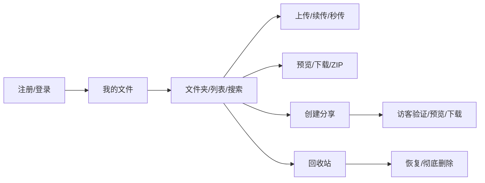
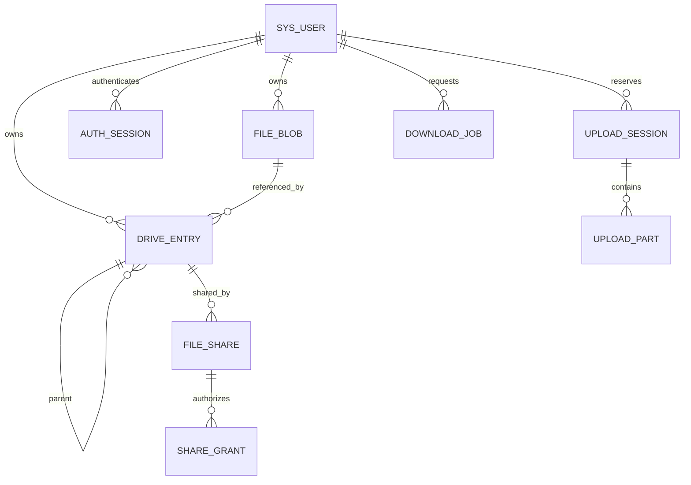
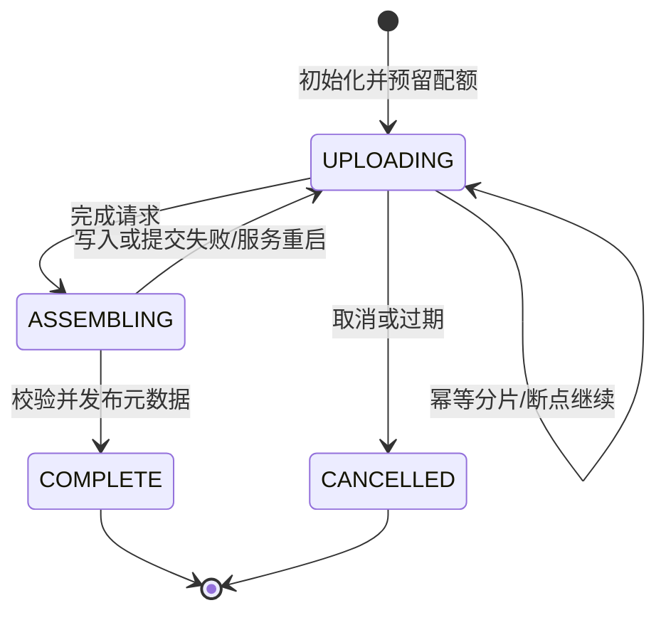

# CloudNest 设计说明

## 使用流程与页面

登录页提供注册/登录及字段校验；主页面提供侧边导航、真实容量和分类统计、目录面包屑、搜索、排序、列表/网格、文件操作与上传面板；回收站显示删除批次根条目；分享页包含管理列表和公开访问页；资料弹窗修改显示名称。

## 模块与数据

前后端单独构建；生产由 Nginx 提供前端并代理 API。认证与资源授权在后端执行；数据库使用 MyBatis-Plus 查询账户，复杂目录/配额操作使用 Spring JDBC 和显式事务。所有参数值使用绑定参数；动态排序字段来自固定白名单。

字段类型、外键、索引和约束以 `cloudnest-server/src/main/resources/db/migration/{h2,mysql}/V1__schema.sql` 为权威定义。`active_name` 在有效条目中取 name，在回收站取 NULL，用于保证有效名称唯一同时保留任意数量的历史删除条目。根条目 parent_id 为 NULL，账号内 root_id 唯一指向其真实根目录。

名称：NFC 规范化、去除首尾空白、大小写敏感，最多 180 个 UTF-16 单元；禁止斜杠、反斜杠、控制字符、空名称和点路径。文件与文件夹可同名；账号仅允许 3～40 个 ASCII 字母、数字和下划线，转为小写后唯一。

## 上传状态机与一致性

服务端保存分片编号、大小与 SHA-256；分片请求流式落到受限私有目录，校验后才登记。合并时再次核对每片与整体摘要；流式写入最终存储后，在用户行锁事务中创建 blob/entry、结算配额和完成会话。重复完成返回同一个 fileId。

事务发布失败时会话仍可重试，候选对象通过持久 object_key 关联，不会产生无法追踪的对象。取消/过期释放配额一次；定时任务重试清理分片和未引用候选。READY blob 才允许读取；彻底删除最后引用后 blob 标为 DELETING，物理清理成功才删除其数据库记录。

上传完成时重新检查目录、名称和状态；目录被删除、重命名冲突或哈希错误不会发布无效条目。前端每文件并发三片、最多三次重试，文件队列串行处理。未完成会话最长保留 24 小时，每用户最多 20 个。

## 并发、回收站与配额

同一用户元数据修改通过 `SELECT ... FOR UPDATE` 串行化，防止并发目录移动成环、同名写入及配额超额。耗时传输不持有用户行锁；单实例内会话条带锁协调分片、完成与取消。

删除目录会标记当前有效子树为同一批次；此前删除的条目保留自己的批次。恢复只恢复选中子树中同批次条目。父目录不可用时移到根目录；恢复重名时追加后缀。彻底删除目录会删除其中所有已删除后代，包括先前独立删除的内容，UI 在操作前明确提示。

配额按所有逻辑文件（包括回收站）计数。初始化预留、完成结算、取消释放、彻底删除扣减均在事务内。blob 物理去重不影响逻辑计量。维护工具可核对/重算已用和预留，并对 READY 对象重新计算摘要。

## 安全与存储边界

JWT 存放在 HttpOnly Cookie；数据库会话允许立即退出失效。CSRF 使用 Spring Security CookieCsrfTokenRepository；写请求先取得当前安全令牌，避免登录后轮换导致失配。生产 Cookie Secure，前后端同源，不开放通配跨域。

对象 Key 仅由后端生成，用户路径不映射到磁盘路径。预览 MIME 由 Tika 内容识别；危险类型不内联，纯文本以文本渲染。下载/预览支持单个 HTTP Range，所有资源 ID、上传会话、ZIP 任务均检查所属用户。

分享 token 与访客授权 token 使用 256 位随机值，仅在库内保存摘要；提取码 BCrypt 存储。分享读取每次检查期限、撤销状态、源文件和下载权限。源文件删除立即撤销分享，恢复不复活链接。Redis 启用时限流失败关闭；开发采用有界的单实例内存窗口。

本地/MinIO 都通过 StorageService 访问。迁移工具先复制、核验摘要，再切换 blob.backend；保留本地源对象供回退，不自动删除原始文件。
