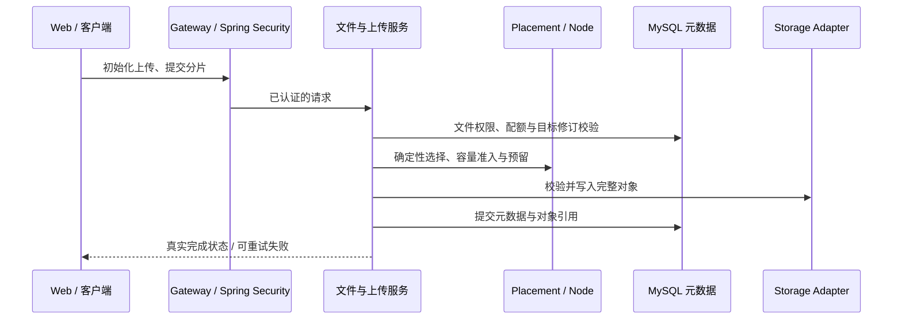
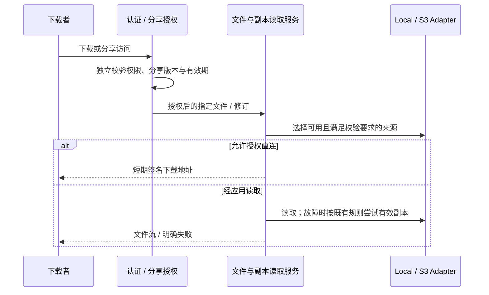
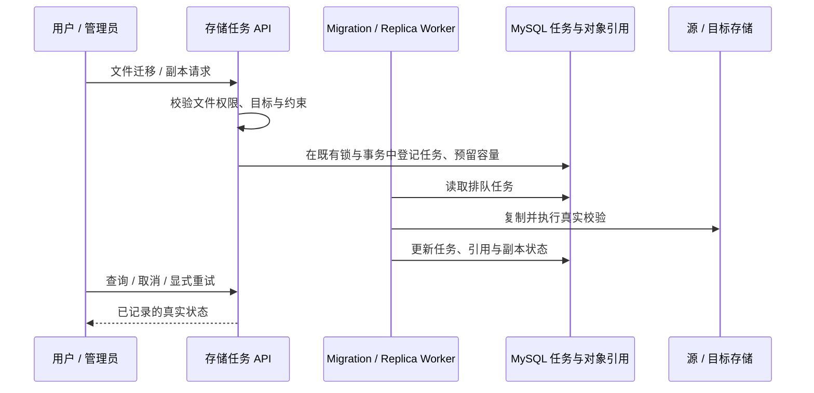

# 单进程控制平面边界

已建立可独立鉴权的只读存储诊断边界和首批手动诊断工具；下面时序展示当前逻辑分工，
不是独立 Controller 或多实例部署已经可用的承诺。

## 现有调用流

## 已落地接口

`StorageDiagnostics.overview(actorId)` 只读取数据库指标，不检测节点、不预留容量，
也不调用迁移。`DatabaseStorageDiagnostics` 每次调用执行管理员校验；
现有控制器继续先做管理员校验，保留原 URL、字段与返回条数限制。
现有集成测试和服务直接调用测试覆盖非管理员拒绝。

`overview` 继续供原管理 UI 使用。Agent 工具使用另外五类受限查询：节点状态、容量、事件、活动任务和策略。
每个方法再次鉴权，查询字段映射为明确 DTO，返回条数受限。`AgentToolRegistry` 负责工具白名单、严格参数、
限流与结果大小校验；手动工具 API 另限制请求体大小并拒绝重复 JSON 键。
完整管理视图不会直接传给工具或模型；后续模型循环仍需单独实现注入边界和持久化审计。
见 [只读工具说明](../agent-tools.md)。

`WORKER_ENABLED=false` 关闭此进程的 Spring 定时任务；维护模式始终不启用调度。
默认单进程保持 `true`。这不关闭启动初始化或请求触发任务，也不是只读模式。
多个应用进程仍可能有启动恢复、上传暂存和任务状态假设，尚不支持多实例部署。
未来需要逐项验证数据库租约、fencing token、任务重领、对象并发、会话和共享临时文件。
